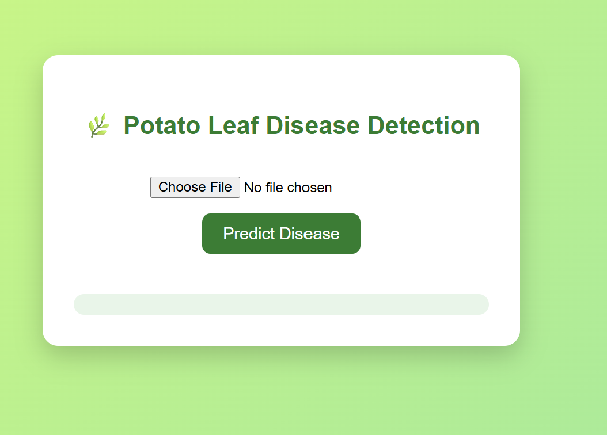
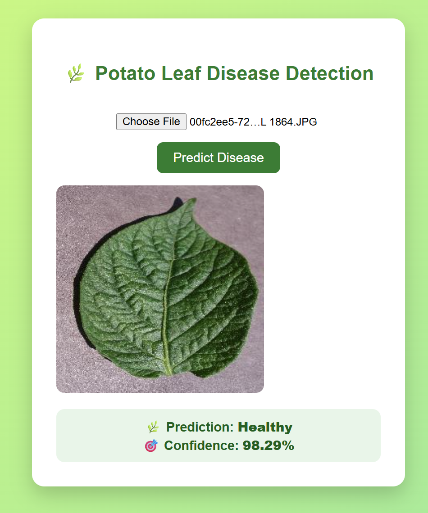
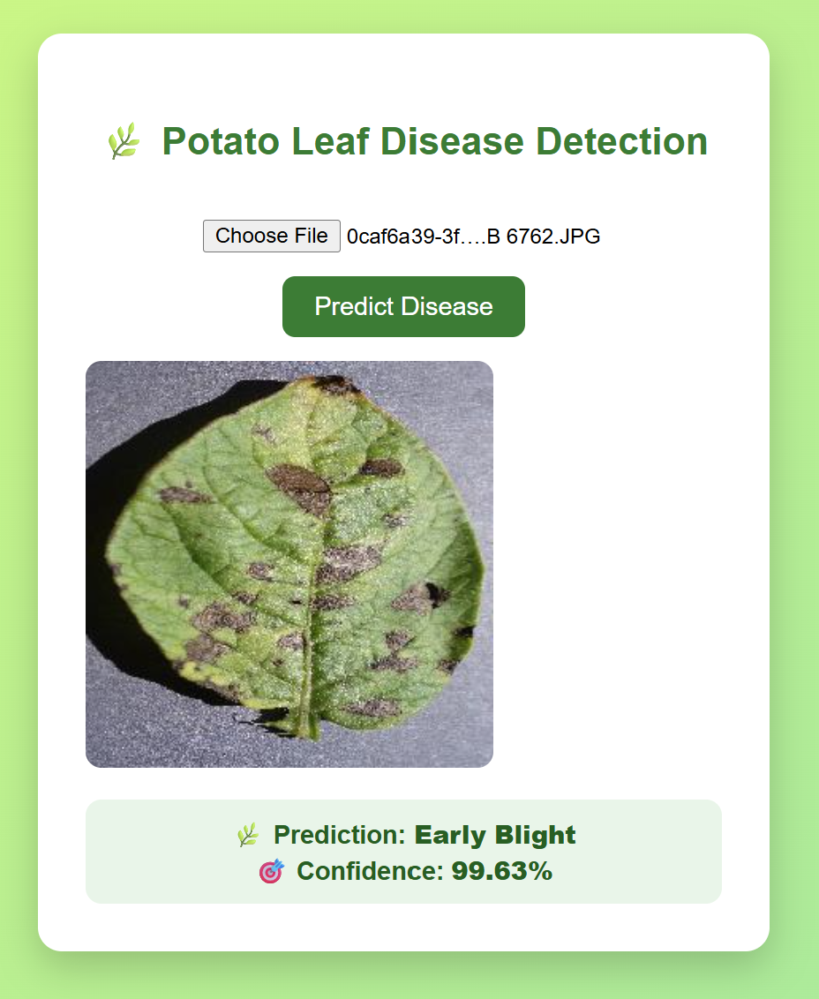
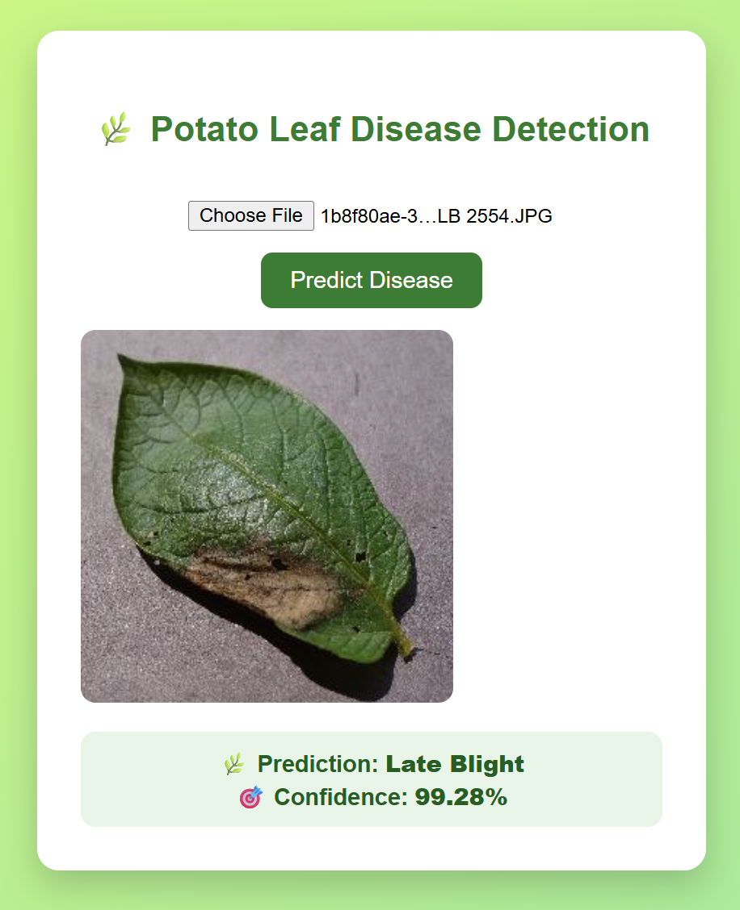

# 🥔 AI-Based Potato Leaf Disease Detection Using EfficientNetB3

### A Deep Learning and Web-Based Approach for Automated Crop Disease Diagnosis

<p align="center">
  <b>An AI-powered application for automated identification of potato leaf diseases using Deep Learning and EfficientNetB3.</b>
</p>

---

## 📌 Project Overview

Potato is one of the most important agricultural crops, but its productivity is affected by various plant diseases. Early identification of these diseases is essential to minimize crop damage and support timely agricultural intervention.

This project presents an **AI-Based Potato Leaf Disease Detection System** that uses Deep Learning and the EfficientNetB3 architecture to automatically classify potato leaf images into three categories:

- Early Blight
- Late Blight
- Healthy

The trained deep learning model is integrated into a web-based application, allowing users to upload potato leaf images and receive automated predictions through a simple and user-friendly interface.

The primary objective is to demonstrate how Artificial Intelligence and Deep Learning can support automated plant disease diagnosis.

## 🎯 Project Objectives

- Develop a deep learning-based potato leaf disease classification system.
- Identify Early Blight, Late Blight, and Healthy potato leaves.
- Utilize EfficientNetB3 with transfer learning for image classification.
- Integrate the trained model into a web-based application.
- Provide an accessible interface for automated disease prediction.

## ✨ Key Features

- **Automated Disease Detection:** Predicts potato leaf conditions from uploaded images.
- **Three-Class Classification:** Identifies Early Blight, Late Blight, and Healthy leaves.
- **EfficientNetB3 Architecture:** Uses a powerful convolutional neural network.
- **Transfer Learning:** Leverages pretrained image features for classification.
- **Web-Based Application:** Provides an easy-to-use interface.
- **Automated Prediction:** Generates predictions after image submission.

---

## 🖥️ Application Screenshots

### 1. Home Page



### 2. Healthy Leaf Detection



### 3. Early Blight Detection



### 4. Late Blight Detection




---

## 🧠 Model Architecture

This project uses **EfficientNetB3**, a convolutional neural network architecture designed to achieve a balance between model accuracy and computational efficiency.

EfficientNetB3 is utilized through transfer learning to extract meaningful features from potato leaf images and classify them into the target disease categories.

### Classification Categories

| Class | Description |
|---|---|
| Early Blight | Potato leaf affected by Early Blight |
| Late Blight | Potato leaf affected by Late Blight |
| Healthy | Healthy potato leaf without visible disease symptoms |

## 📊 Dataset

The model is trained using potato leaf images from the **PlantVillage dataset**.

| Category | Number of Images |
|---|---:|
| Potato Early Blight | 1,000 |
| Potato Late Blight | 1,000 |
| Potato Healthy | 152 |
| **Total** | **2,152** |

The dataset contains images representing the three target categories used for model training and evaluation.

## 📈 Model Performance

The EfficientNetB3 model achieved the following validation results:

| Evaluation Metric | Result |
|---|---:|
| Validation Accuracy | **96.05%** |
| Validation Loss | **0.1285** |

These results demonstrate the model's classification performance on the validation dataset.

*Note: Validation performance does not guarantee identical accuracy on real-world images.*

---

## 🛠️ Technologies Used

| Technology | Purpose |
|---|---|
| Python | Core programming language |
| TensorFlow | Deep learning framework |
| Keras | Model development and training |
| EfficientNetB3 | Image classification architecture |
| OpenCV | Image processing |
| NumPy | Numerical computations |
| Matplotlib | Data visualization |
| Flask | Backend web framework |
| HTML5 | Web page structure |
| CSS3 | Styling and design |
| Bootstrap | Responsive user interface |

---

## 📂 Project Structure

```text
Plant/
│
├── backend/
│   ├── app.py
│   ├── best_model.keras
│   └── requirements.txt
│
├── screenshots/
│   ├── home.png
│   ├── upload.png
│   ├── early_blight.png
│   ├── late_blight.png
│   └── healthy.png
│
├── research_papers/
│   └── Plant_disease_research_paper.pdf
│
└── README.md
```

*Note: This is the illustrative project structure. Update filenames if your actual repository differs.*

---

## ⚙️ Installation and Setup

Follow these steps to run the project locally.

### 1. Clone the Repository

```bash
git clone https://github.com/Pratik-238/Plant.git
```

### 2. Navigate to the Backend Directory

```bash
cd Plant/backend
```

### 3. Create a Virtual Environment

```bash
python -m venv venv
```

### 4. Activate the Virtual Environment

For Windows:

```bash
venv\Scripts\activate
```

### 5. Install Dependencies

```bash
pip install -r requirements.txt
```

### 6. Run the Application

```bash
python app.py
```

### 7. Open the Application

Open your browser and visit:

```text
http://127.0.0.1:5000/
```

The application should now be accessible locally.

---

## 🔍 How the System Works

The application follows a simple image classification workflow:

1. **Image Upload:** The user uploads a potato leaf image through the web interface.
2. **Image Preprocessing:** The uploaded image is resized and preprocessed according to the model's input requirements.
3. **Feature Extraction:** EfficientNetB3 extracts relevant visual features from the image.
4. **Classification:** The trained model predicts the corresponding category.
5. **Prediction Display:** The predicted class is displayed on the web application.

---

## 📚 Research Paper

As part of this project, a research paper has been prepared to document the proposed potato leaf disease detection system, its methodology, model architecture, implementation, and experimental results.

The paper provides a detailed explanation of the EfficientNetB3-based approach for automated potato leaf disease classification.

**Research Paper:** AI-Based Potato Leaf Disease Detection Using EfficientNetB3

📄 **[View / Download Research Paper (PDF)](Pratik_Salunkhe_Research_Paper.pdf)**

### Topics Covered

- Introduction and problem statement
- Literature review
- Dataset description and preprocessing
- Proposed methodology
- EfficientNetB3 model architecture
- Model training and evaluation
- Experimental results and conclusion

*This is an academic project research paper and should not be considered a published journal article unless formally published.*

---

## 🚀 Future Enhancements

- Extend disease detection to additional crops.
- Increase dataset diversity to improve real-world generalization.
- Incorporate disease prevention and management recommendations.
- Deploy the application on a cloud platform.
- Develop a mobile-friendly application for agricultural use.

---

## 👩‍💻 Project Information

| Detail | Description |
|---|---|
| Project Title | AI-Based Potato Leaf Disease Detection Using EfficientNetB3 |
| Domain | Artificial Intelligence and Deep Learning |
| Model Architecture | EfficientNetB3 |
| Framework | TensorFlow / Keras |
| Classification Type | Multi-Class Image Classification |
| Backend | Flask |
| Dataset | PlantVillage |
| Application | Web-Based Disease Detection System |

---

## 🙏 Acknowledgements

- PlantVillage dataset for providing plant leaf images for research and experimentation.
- TensorFlow and Keras for deep learning development.
- The open-source community for providing useful tools and libraries.

---

<p align="center">
  <b>Developed as an academic project using Artificial Intelligence and Deep Learning.</b>
</p>

<p align="center">
  ⭐ If you find this project useful, consider giving the repository a star!
</p>
